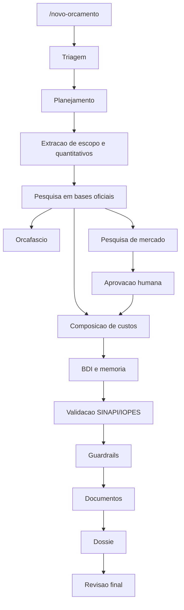

# Arquitetura da Central Orca

## Visao Geral

A Central Orca e um kit Antigravity para produzir orcamentos publicos de obras e servicos de engenharia com agentes, skills, workflows, templates e scripts.

## Agentes

- `central-orchestrator`
- `intake-triage-agent`
- `project-planner`
- `engenheiro-orcamentista-publico`
- `orcamentista-mgi-es`
- `compositor-custos`
- `pesquisador-bases-oficiais`
- `pesquisador-mercado`
- `validador-codigos`
- `guardrail-controladoria`
- `documentalista-tecnico`
- `revisor-final`

## Subagentes

- `browser-orcafascio-subagent`
- `spreadsheet-normalizer-subagent`
- `pdf-docx-extractor-subagent`
- `quantity-takeoff-subagent`
- `quotation-harvester-subagent`
- `code-validator-subagent`
- `bdi-calculator-subagent`
- `document-renderer-subagent`
- `approval-notifier-subagent`

## Workflows

- `/novo-orcamento`
- `/orcafascio`
- `/pesquisar-precos`
- `/validar-orcamento`
- `/gerar-documentos`
- `/gerar-dossie`
- `/status-orca`
- `/revisar-final`

## Fluxo Principal

## Artefatos Obrigatorios por Projeto

- `projeto.md`
- `plano-execucao.md`
- `log-decisoes.md`
- planilha normalizada
- memoria de calculo
- demonstrativo de BDI
- validacao de codigos
- relatorio de guardrails
- documento tecnico
- indice do dossie
- checklist final

